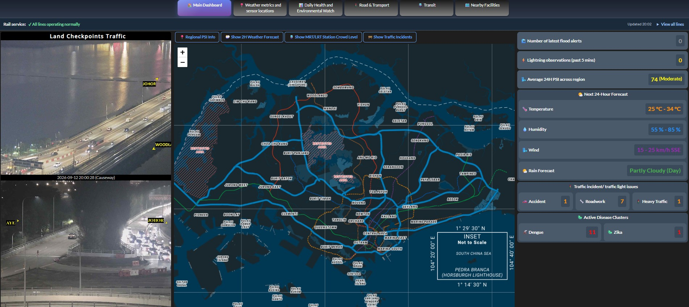
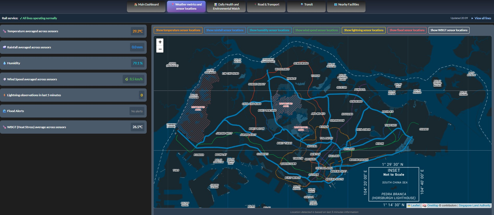
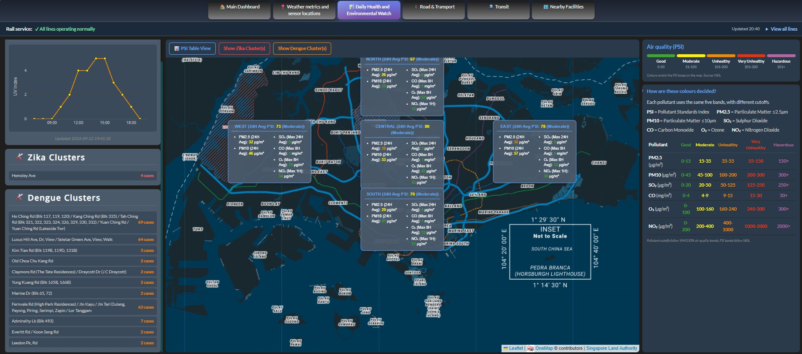
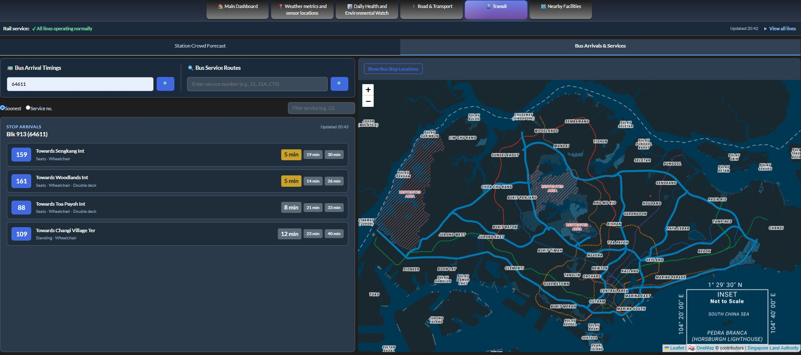
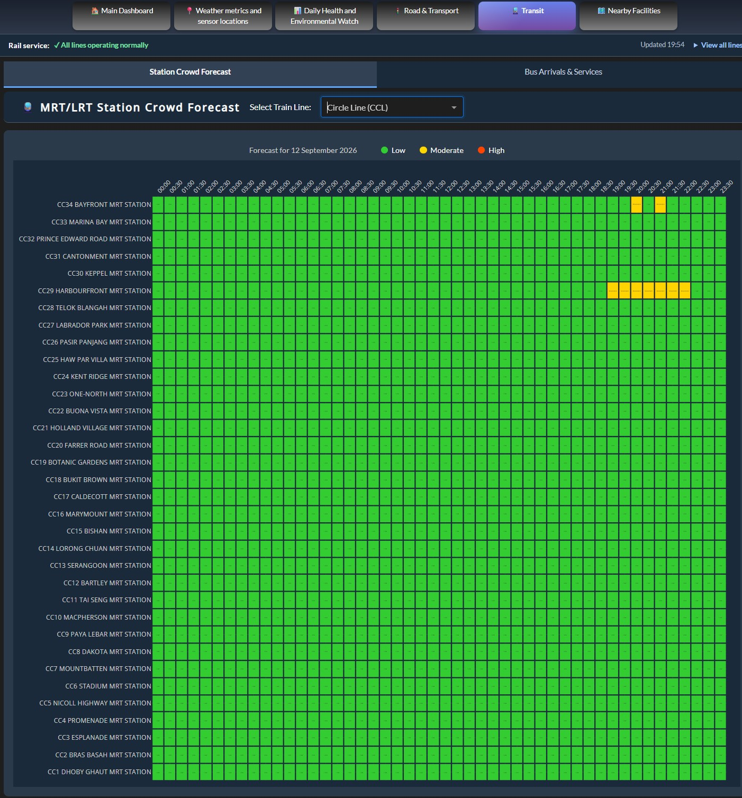
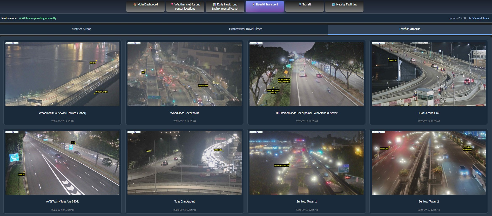

# Land Transport and Weather Dashboard

A Dash app for Singapore that pulls near real-time weather, health, and land-transport data onto interactive maps. Use it to scan alerts, search nearby facilities, and check bus, rail, and road conditions in one place.

## How it works

`app.py` starts the Dash server, registers callbacks, and downloads static datasets on first run (HDB carpark, speed cameras, EV charging batch). Pages live in `components/`. Callbacks in `callbacks/` stay thin and call helpers in `utils/`. Runtime URLs and dataset IDs live in `conf/api_urls.py` — do not hardcode API hosts elsewhere (`tests/unit/test_api_urls.py` fails the build if they leak).

Maps use OneMap night tiles via **dash-leaflet** `LayerGroup` / `DivMarker` layers. API work runs off the UI thread with `@run_in_thread`. Poll intervals are in `conf/cache_config.py`.

Non-main tabs are built on first visit (`callbacks/tab_navigation_callback.py`). After layout changes, restart the app — `dev_tools_hot_reload` is off.

## Tech stack

| Layer | Choice |
| --- | --- |
| Runtime | Python **≥ 3.12** |
| App | [Dash](https://dash.plotly.com/) + [dash-bootstrap-components](https://dash-bootstrap-components.opensource.faculty.ai/) |
| Maps | [dash-leaflet](https://www.dash-leaflet.com/) ≥ 1.0 (1.1+ has no `MarkerClusterGroup`) |
| Charts | [Plotly](https://plotly.com/python/) |
| HTTP / env | `requests`, `python-dotenv` |
| Data | `pandas`, `numpy`, `pyproj`, `geopy`, `gtfs-realtime-bindings` |
| Package manager | [uv](https://docs.astral.sh/uv/) |
| Tests | `pytest` (`uv run pytest tests/unit`) |
| Deploy | `gunicorn` (see [DEPLOYMENT.md](DEPLOYMENT.md)) |

## Pages

Six top-level tabs (`components/banner_component.py`):

1. **Main Dashboard** — PSI average, flood/lightning counts, 24-hour forecast, traffic incidents, MRT/LRT line status, dengue/zika counts, location search, nearby MRT / bus / HDB carpark, and checkpoint camera stills.
2. **Weather metrics and sensor locations** — Live temperature, rainfall, humidity, wind, WBGT, lightning, and flood alerts, plus sensor-location toggles.
3. **Daily Health and Environmental Watch** — UV trend, regional PSI (map boxes or table), dengue/zika polygons. The right panel is a PSI colour strip with a “How are these colours decided?” expander (`components/air_quality_legend.py`). Bands live in `conf/weather_indices_config.py`.
4. **Road & Transport** — Inner tabs:
   - **Metrics & Map** — taxis, cameras, ERP gantries, taxi stands, bus stops (zoom 15+), VMS, line status.
   - **Expressway Travel Times** — LTA EstTravelTimes chains grouped by expressway and direction.
   - **Traffic Cameras** — full camera grid (some LTA feeds are being switched off).
5. **Transit** — Inner tabs:
   - **Station Crowd Forecast** — LTA PCD crowd levels by line.
   - **Bus Arrivals & Services** — search by stop code or service number (searching one box clears the other).
6. **Nearby Facilities** — Address search in the left panel. Type at least 3 characters, then press **Enter** or **Search** (not on every keystroke). One match is selected automatically; several matches appear in a dropdown. Lists show the nearest 5 as compact name + distance rows; addresses and extra detail stay in map popups. Inner tabs:
   - **Getting around** — bus stops, MRT/LRT, taxi stands (default).
   - **Park and charge** — HDB carparks, bicycle parking, EV chargers.
   - **Amenities** — parks, sports fields, recycling bins, hawker centres, plus map overlay toggles.

## Project layout

```
app.py                 # Dash entry, startup downloads, callback registration
auth/                  # OneMap token
callbacks/             # Dash callbacks
components/            # Page and shared UI layouts
conf/
  api_urls.py          # Only source of API bases, endpoints, dataset IDs
  cache_config.py      # Poll intervals and TTLs
  weather_indices_config.py  # PSI / pollutant / WBGT bands (not URLs)
  mrt_line_config.py   # Line colours and names
  page_layout_config.py
utils/                 # Fetchers, parsers, map and transport helpers
tests/unit/            # pytest
assets/                # CSS, JS, screenshots
data/                  # Downloaded CSVs / JSON (created at runtime)
```

## Data sources

Live and dataset APIs are listed in `conf/api_urls.py`. Sign-up and deprecation notes: [Data.gov.sg developer guide](https://guide.data.gov.sg/developers).

**Data.gov.sg** — weather V2 (temperature, rainfall, humidity, wind), lightning, flood alerts, UV, WBGT, PSI, 2-hour and 24-hour forecasts, taxi availability, traffic images. Poll/initiate-download datasets: HDB carparks, speed cameras, ERP gantries, parks, sports fields, recycling bins, hawker centres, dengue and zika clusters.

**LTA DataMall** — bus stops/routes/services/arrivals, taxi stands, bicycle parking, carpark availability, expressway travel times, platform crowd (forecast and realtime), train service alerts plus GTFS-Realtime alerts and trip updates, traffic incidents, faulty traffic lights, VMS, EV charging.

**OneMap** — night map tiles, address search, nearest bus stops and MRT stations.

Station coordinates also use `MRTLRTStations.csv`. A few Thomson–East Coast / Punggol Coast points are mapped manually.

## Screenshots

Files in `assets/img/`:

### Main Dashboard


### Weather metrics


### Daily Health and Environmental Watch


### Bus Arrivals & Services (Transit)


### Station Crowd Forecast (Transit)


### Traffic Cameras (Road & Transport)


## Requirements

1. Python 3.12 or newer.
2. [uv](https://docs.astral.sh/uv/getting-started/installation/).
3. API credentials in a root `.env` file (see below).

```bash
git clone https://github.com/qzq92/Dash-sample-analytics-dashboard-concept.git
cd Dash-sample-analytics-dashboard-concept
uv sync
```

`.venv` is gitignored. Run `uv sync` after every clone. Optional: `uv sync --all-groups` for pylint and pytest.

### Environment variables

```env
DATA_GOV_API=your_data_gov_api_key_here
ONEMAP_EMAIL=your_onemap_email_here
ONEMAP_EMAIL_PASSWORD=your_onemap_password_here
LTA_API_KEY=your_lta_api_key_here
```

| Variable | Where to get it | Used for |
| --- | --- | --- |
| `DATA_GOV_API` | [Request a key](https://guide.data.gov.sg/developer-guide/api-overview/how-to-request-an-api-key) | Weather, PSI, UV, WBGT, taxi availability, traffic images, cluster downloads |
| `ONEMAP_EMAIL` / `ONEMAP_EMAIL_PASSWORD` | [OneMap register](https://www.onemap.gov.sg/apidocs/register) | Address search, nearby bus/MRT, map tiles |
| `LTA_API_KEY` | [DataMall request form](https://datamall.lta.gov.sg/content/datamall/en/request-for-api.html) | Bus arrivals and routes, carparks, taxi stands, bicycle parking, EV, VMS, travel times, crowd, train alerts (including GTFS) |

## Run locally

```bash
uv sync
uv run .\app.py
```

Or activate the venv (`source .venv/bin/activate` on Unix, `.venv\Scripts\activate` on Windows) and run `python app.py`.

Open [http://127.0.0.1:8050/](http://127.0.0.1:8050/). The process binds `0.0.0.0:8050` outside conda.

On first start the app creates `data/` if needed, downloads missing static files, and requests an OneMap token.

### Tests and lint

```bash
uv run pytest tests/unit
uv run pylint callbacks components conf utils app.py
```

CI (`.github/workflows/lint.yml`) runs the same checks on `main_v2`.

## How development is structured

- Put new HTTP endpoints in `conf/api_urls.py` and import them.
- Keep fetch/parse logic in `utils/`; callbacks should compose UI from that data.
- Keep script files at or under 700 lines.
- Add or update a unit test with each behaviour change.
- After UI work, restart `uv run .\app.py` and exercise the tab (hot reload is disabled).

## Known limitations

- Bus stop markers on Road & Transport appear only at zoom 15+ and only in the current viewport.
- Stop markers can sit off the kerb when roads are under construction (disclaimer is shown with the layer).
- Some LTA traffic-camera stills no longer load as feeds are retired.
- Nearby Facilities search does not query OneMap until Enter or the Search button.

## Deployment

Plotly Cloud / gunicorn notes are in [DEPLOYMENT.md](DEPLOYMENT.md). Set the same four environment variables in the host.
